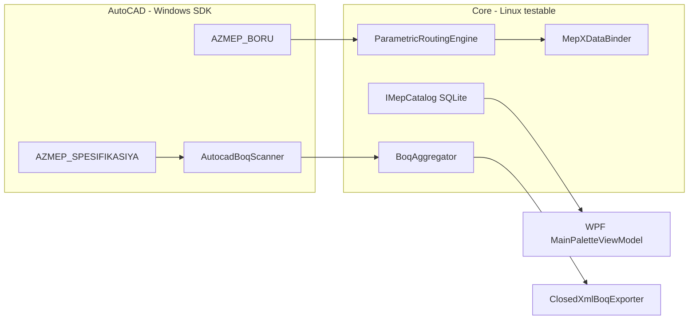

# AzMEP CAD — Architecture / Arxitektura

Open-source MEP automation plugin for AutoCAD-class hosts. Inspired by general CAD+MEP workflows (e.g. CADprofi-style palettes, routing, BOQ); **does not ship or depend on proprietary CADprofi databases or assets**.

## Usage flow / İstifadə axını



1. **Kataloq** — `SqliteMepCatalog` + `JsonSeedImporter` (`schema.sql`, `demo-pipe-sizes.json`, `demo-fittings.json`).
2. **Marşrut** — `AZMEP_BORU` polyline nöqtələrini toplayır; `RoutingSegment` + `FittingPlacement` (dirsek, T, reduktor).
3. **XData** — `MepXDataSchema` / regapp `AZMEP`; `AutoCadXDataService` entity-lərə yazır.
4. **Smeta** — `AutocadBoqScanner` → `BoqAggregator` → Excel (**Borular**, **Armatur**).
5. **Palitra** — `MainPaletteViewModel` kateqoriyalar (HVAC, Boru, Elektrik, Memarlıq); AutoCAD-də `PaletteSet` ilə host ([README](../src/AzMepCad.AutoCAD/README.md)).

## Modules / Modullar

| Project | Role | CAD dependency |
|---------|------|----------------|
| `AzMepCad.Core` | Domain models, `IMepCatalog`, `MepXDataBinder`, SQLite | None |
| `AzMepCad.Routing` | `IRoutingEngine` — segments, fittings | None |
| `AzMepCad.Boq` | `BoqAggregator`, `ClosedXmlBoqExporter` | None |
| `AzMepCad.UI` | WPF palette, `MainPaletteViewModel`, `az-AZ` `.resx` | WPF (Windows) |
| `AzMepCad.AutoCAD` | `AzMepPlugin`, commands, XData service, BOQ scan | AutoCAD 2025+ managed API |

### Core interfaces

- **IMepCatalog** — `GetPipeSizesAsync`, `GetFittingAsync`, search
- **IRoutingEngine** — `RoutingSegment`, `FittingPlacement`, `BranchStub` for tees
- **IXDataBinder** / **MepXDataBinder** — AZMEP typed keys
- **IMepDrawingScanner** — model space scan (AutoCAD implementation)
- **IBoqExporter** — Excel / CSV smeta

## Data model / Məlumat modeli

- **SQLite** (`data/catalog/schema.sql`): `mep_components`, `mep_standards`, `pipe_size_standards`, `mep_fittings`
- **JSON seed** (`data/catalog/seed/`): demo public DIN dimensions and fittings only
- Drawing persistence: XData regapp **`AZMEP`** (`MepXDataSchema`)

## Target platforms

| Host | .NET | Notes |
|------|------|-------|
| AutoCAD 2025+ | **.NET 8** (this repo default) | Set `AUTOCAD_SDK_DIR` to folder with `AcDbMgd.dll` |
| AutoCAD 2019–2024 | .NET Framework **4.8** (Phase 2 split) | Duplicate plugin projects targeting `net48` |
| BricsCAD / ZWCAD | Vendor .NET API | Phase 2 adapters |

Build AutoCAD layer without SDK (CI/Linux):

```bash
dotnet build src/AzMepCad.AutoCAD/AzMepCad.AutoCAD.csproj
# defines AZMEP_NO_AUTOCAD_SDK
```

## Roadmap

### Phase 1 — Scaffold (current)

- Catalog + JSON import, routing with elbows/tees/reducers, XData binder, BOQ sheets, az-AZ commands (SDK-gated)

### Phase 2 — Drawing integration

- Palette dock in AutoCAD, block-based fittings, user catalog import

### Phase 3 — Production MEP

- Open-standard fitting libraries, layer standards, BricsCAD/ZWCAD adapters

## Ethical / legal note

Do **not** commit proprietary databases, symbols, or licensed content into this repository.
